# 

<!-- <h1 align="center">Muhammad Husnil Malak</h1> -->

  <!-- <strong>alhsnmlk</strong>  -->
  💻 Coding Enthusiast | 🎨 UI/UX Designer | 🌐 Front End Developer | 👨‍💻 Software Engineer | 🎬 Video Editor | 🖌️ Graphic Designer

  
  
  

## Tech Stack

  
  
  
  
  
  
  
  
  
  
  
  
  

### Martial Arts

  
  

## Currently Building

Building desktop applications with focus on user experience, clean design, and practical functionality.

## GitHub Statistics

  

  <picture>
    <source media="(prefers-color-scheme: dark)" srcset="https://raw.githubusercontent.com/alhsnmlk-pl/alhsnmlk-pl/output/galaga-contribution-graph-dark.svg" />
    <source media="(prefers-color-scheme: light)" srcset="https://raw.githubusercontent.com/alhsnmlk-pl/alhsnmlk-pl/output/galaga-contribution-graph.svg" />
    
  </picture>

